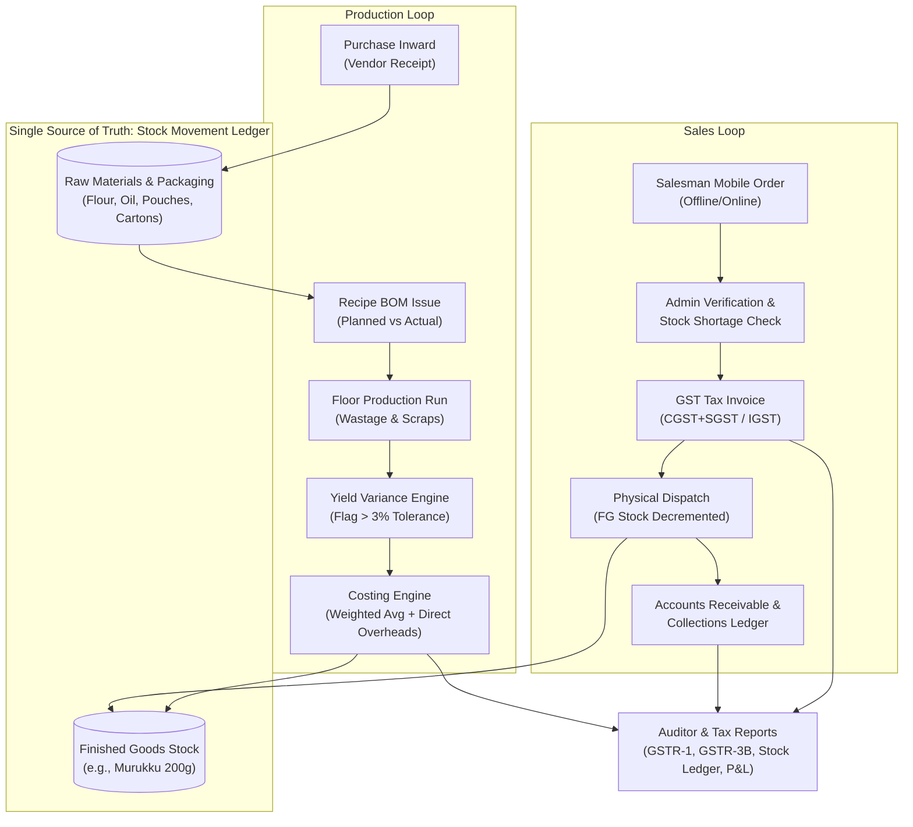
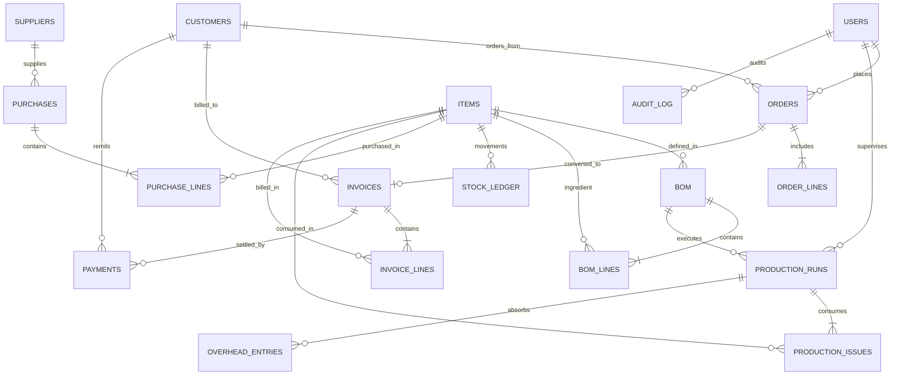

# Design Note: Order-to-Audit Food Manufacturing ERP

**Institution:** Centre for Digital Infrastructure, NIT Tiruchirappalli  
**Project:** Order-to-Audit System for Packaged Food Manufacturing (Sri Lakshmi Foods)  
**Author:** Shreedhar K B  

---

## 1. Executive Architecture & Core Philosophy

The primary objective is linking the **Sales Loop** (Order → Verification → GST Invoicing → Dispatch → Accounts Receivable) and the **Production Loop** (Purchasing → Raw Stock → Recipe BOM Issue → Floor Production Run → Yield Variance & Packet Costing) at the unified **Finished-Goods Stock Ledger**.

---

## 2. Complete Data Model & Entity Relationship

All monetary quantities are modeled as **64-bit BigInt paisa** (1 Rupee = 100 Paisa), completely avoiding IEEE-754 floating-point rounding errors. Quantities are persisted in `NUMERIC(15,4)` with standardized metric conversions.

---

## 3. Stock Computation & BOM Consumption Engine

### 3.1 Strict Movement-Ledger Inventory
No item row contains an arbitrary static balance column. Stock balance at any instant $t$ is strictly derived from the immutable transaction ledger:
$$\text{Closing Balance}_i = \sum \text{QtyIn}_i - \sum \text{QtyOut}_i$$

Movement categories:
- `purchase`: Increases raw/packaging materials.
- `production_issue`: Decreases raw ingredients & packaging (pouches/cartons) against a batch run.
- `production_output`: Increases finished goods upon batch completion.
- `sale_dispatch`: Decreases finished goods upon physical truck dispatch.
- `wastage`: Logs damaged pouches or burnt dough.

### 3.2 Recipe BOM Multipliers & Yield Variance Logic
Given standard batch output $Y_{\text{std}}$ and BOM standard line quantity $Q_{\text{std}}$, for a run multiplier $M$:
$$\text{Planned Quantity} = Q_{\text{std}} \times M$$
$$\text{Consumption Variance \%} = \frac{\text{Actual Used} - \text{Planned Quantity}}{\text{Planned Quantity}} \times 100$$
$$\text{Yield Variance \%} = \frac{\text{Actual Good Output} - (Y_{\text{std}} \times M)}{Y_{\text{std}} \times M} \times 100$$

When $|\text{Variance \%}| > \text{Tolerance}$ (configured at 3%), the system triggers automated variance flags across the Supervisor and Owner dashboards.

---

## 4. Costing & Valuation Methodology

### 4.1 Weighted Average Cost (WAC) Valuation
In food manufacturing where flour, edible oils, and packaging are procured in staggered lots with volatile rates, **Weighted Average Costing** guarantees smooth cost absorption:
$$\text{WAC Rate} = \frac{\sum (\text{QtyIn}_k \times \text{RatePaisa}_k)}{\sum \text{QtyIn}_k}$$

### 4.2 Overhead Allocation Rule
Overheads are classified into:
1. **Direct Batch Overheads:** Labour directly assigned to the frying/packing shift.
2. **Utilities:** Metered LPG commercial gas and baking/cooling electrical units.

$$\text{Total Batch Cost} = \sum_{\text{issues}} (\text{ActualQty} \times \text{WAC Rate}) + \text{Direct Labour} + \text{Gas \& Power}$$
$$\text{Cost per Packet} = \frac{\text{Total Batch Cost}}{\text{Actual Good Packets Produced}}$$
$$\text{Gross Margin \%} = \frac{\text{Selling Price} - \text{Cost per Packet}}{\text{Selling Price}} \times 100$$

---

## 5. Indian GST Statutory Engine

- **Place of Supply Rule:** Company State Code = `33` (Tamil Nadu).
- If Customer State Code $= 33$: **Intra-State Supply** $\implies$ Split equally into $\text{CGST } 2.5\% + \text{SGST } 2.5\%$.
- If Customer State Code $\neq 33$: **Inter-State Supply** $\implies$ Charge full $\text{IGST } 5.0\%$.
- Sequential statutory numbering per financial year: `INV/2024-25/0001`.
