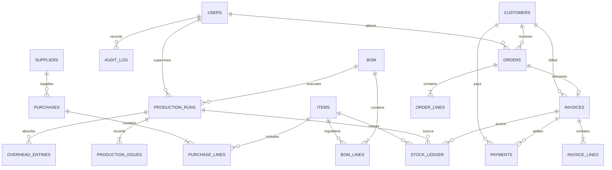

# FactoryLoop — Design Note

**Author:** Shreedhar K B

FactoryLoop connects the sales loop (order → verification → GST invoice → dispatch → receivables) with the production loop (purchase → BOM issue → output → variance/cost) through one stock ledger. React calls an Express API; domain services write PostgreSQL transactions behind JWT role checks.

## 1. Data model



`stock_ledger.txn_ref_type` and `txn_ref_id` identify the source purchase, run, invoice, or adjustment. No editable balance field exists. Stock, source documents, and audit rows commit in one transaction.

Money is integer paisa in PostgreSQL `BIGINT`; JavaScript uses safe integers. Quantities use `NUMERIC(15,4)`. WIP is not a separate stock account; `production_runs.status` tracks draft through completion.

## 2. Stock and BOM computation

```text
balance = SUM(qty_in) - SUM(qty_out)
planned quantity = Q × M
consumption variance % = (A - planned) / planned × 100
yield variance % = (actual output - expected yield × M) / (expected yield × M) × 100
```

`Q` is BOM quantity per batch, `M` is batch multiplier, and `A` is actual issue. Purchases add stock; issues remove raw materials; completion removes packaging and adds finished goods; dispatch removes finished goods. Cancellation posts an offsetting `sale_return`.

kg/g and litre/ml normalize automatically; incompatible count units are rejected. Pouches consumed equal good packets plus damaged pouches. Carton use is explicit or calculated from pack capacity. Absolute variance above 3% is flagged.

## 3. Costing and valuation

```text
net quantity = SUM(qty_in) - SUM(qty_out)
net value   = SUM(qty_in × rate_paisa) - SUM(qty_out × rate_paisa)
WAC rate    = ROUND(net value / net quantity)
batch cost  = issues at WAC + direct labour + gas/power
cost/packet = ROUND(batch cost / actual good output)
margin      = selling price - cost per packet
```

Outward movements store the rate used at that time. Labour and utilities are directly assigned to the run; no monthly overhead pool is allocated.

| Benchmark component | Cost |
| --- | ---: |
| Materials and packaging | ₹4,055.20 |
| Labour | ₹1,200.00 |
| Gas/power | ₹600.00 |
| **Total** | **₹5,855.20** |

`₹5,855.20 ÷ 188 = ₹31.1447`, rounded to **₹31.14 per packet**. Flour WAC rounds from ₹43.125 to ₹43.13/kg, adding ₹0.20 to the batch; packet cost is unchanged. Opening finished goods have zero seeded cost, so reports use new-run cost rather than blended stock WAC. At ₹50 pre-tax, approximate margin is ₹18.86 per packet, or 37.72%.

## 4. Correctness controls

- State code `33`: same-state supply uses CGST + SGST; other-state supply uses IGST. Murukku GST is 5%.
- Invoice and credit-note counters are separate, locked, and sequenced by April–March financial year.
- Production changes, invoice creation/dispatch/cancellation, purchases, payments, and master creation record user, time, and old/new values.
- Invoices are never deleted. Cancellation assigns a credit-note number, reverses payments, and restores stock.

The architecture prioritizes core transactional integrity: full-invoice dispatch, real-time stock summaries, direct run overhead allocation, and auditor exports. All business rules guarantee exact accounting reconciliation between the sales loop and production loop at the finished goods ledger.
