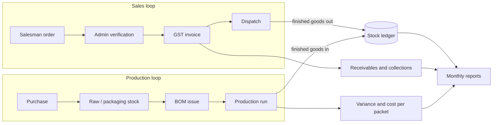

# FactoryLoop — Order-to-Audit Prototype

FactoryLoop is an individual prototype for the NIT Tiruchirappalli internship problem statement. It connects field orders, admin verification, GST billing, dispatch, BOM-based production, stock, costing, collections, and auditor reports in one PostgreSQL-backed system.

## Submission links

| Item | Link or status |
| --- | --- |
| Live web app | https://frontend-fawn-ten-48.vercel.app |
| Live API health | https://backend-zeta-two-82.vercel.app/api/health |
| Public repository | https://github.com/shreedharkb/order-to-audit |
| Author | Shreedhar K B |
| Design note | [DESIGN.md](DESIGN.md) |
| Demo video | Pending: record the Section 5 walkthrough in order, including mobile salesman and admin views, maximum 8 minutes |

## Quick start

```bash
docker compose up --build
```

- Web app: `http://localhost`
- API: `http://localhost:3000/api`
- PostgreSQL: `localhost:5432`

The backend container creates the schema and loads the Section 5 seed data before starting. To reset the demo to a clean benchmark database:

```bash
docker compose down -v
docker compose up --build
```

`down -v` deletes the local Docker database volume and all demo transactions.

## Test logins

All seeded accounts use password `password123`. These are dummy credentials for local and demo use only.

| Role | Username | Main screen |
| --- | --- | --- |
| Salesman A | `salesman_a` | `/salesman/dashboard` |
| Salesman B | `salesman_b` | `/salesman/dashboard` |
| Factory Admin | `admin` | `/admin/dashboard` |
| Production Supervisor | `production` | `/production/dashboard` |
| Accountant / Auditor | `accountant` | `/reports` |
| Owner | `owner` | `/owner/dashboard` |

Salesmen see only their own orders. The accountant has read-only report access. Admin and owner have the broadest operational access; production users manage BOMs, purchases, and production runs.

## Stack and why

React, Vite, React Router, Tailwind CSS, and shadcn-style Radix primitives let one responsive web app serve mobile sales staff and desktop factory users. Node.js/Express keeps the API and domain rules in one language, while PostgreSQL provides relational integrity, transactions, numeric quantities, ledger-based stock, and locked financial-year invoice counters.

| Layer | Technology |
| --- | --- |
| Frontend | React 18, Vite 5, React Router 6, Axios, TanStack Query |
| UI | Tailwind CSS, Radix Dialog/Slot, shadcn-style components |
| Backend | Node.js, Express, JWT, bcrypt |
| Database | PostgreSQL 15, `BIGINT` paisa, `NUMERIC(15,4)` quantities |
| Files | PDFKit GST invoices, ExcelJS report exports |
| Tests | Jest |
| Deployment | Docker Compose, Vercel |

## System flow



Every balance is derived from `stock_ledger`; each movement records `txn_ref_type` and `txn_ref_id` for its purchase, production run, invoice, or adjustment. Business writes use database transactions, and invoice or production changes are written to `audit_log`.

## Features against Section 6

### Must have — complete

| Requirement | Implementation |
| --- | --- |
| Login with at least three roles | Five roles: salesman, admin, production, accountant, owner; backend RBAC and protected frontend routes |
| Product, customer, raw-material and BOM masters | Master APIs and screens; seeded Murukku benchmark data |
| Mobile-friendly order entry and admin approval | Responsive order form, customer/product selection, stock check, edit/approve/reject |
| GST invoice as PDF | GSTIN, HSN, taxable value, CGST/SGST or IGST, place of supply, financial-year numbering |
| Production run updates stock automatically | Raw/packaging issues and finished-goods output post to the ledger on run completion |
| Planned vs actual consumption and yield | BOM multiplier, actual issues, 3% tolerance, flagged yield/material variance |
| Stock summary and stock ledger | Live balances, weighted-average valuation, running ledger and source references |
| Sales register and stock report export | Date-filtered reports exported as `.xlsx` |

### Should have — complete

| Requirement | Implementation |
| --- | --- |
| Purchases and supplier records | Supplier master, purchase entry, receipt ledger and purchase register |
| Payments, outstanding and ageing | Invoice/customer validation, overpayment prevention, FIFO allocation, 0–30/31–60/61–90/90+ buckets |
| Cost per packet with overheads | Weighted-average materials plus direct labour and utilities per run |
| GST summary report | Tax-rate and intra/inter-state outward-supply summary |
| Variance alerts beyond tolerance | Production detail and owner dashboard show yield and material alerts |
| Owner dashboard | Today’s orders, pending approvals, stock, variance alerts, latest packet cost and receivables |

### Stretch goals — partial or not implemented

| Goal | Status |
| --- | --- |
| Offline order capture and sync | Not implemented |
| Batch/expiry and FEFO | Batch/expiry columns exist; batch selection, expiry alerts and FEFO dispatch are not implemented |
| Reorder levels and low-stock alerts | Balance/reorder comparison exists; benchmark items do not have seeded reorder thresholds |
| Production planning from pending orders | Not implemented |
| Salesman route/GPS visit log | Not implemented |
| Tally-compatible export | Not implemented |
| Mock e-Invoice/e-Way Bill | Not implemented |
| Tamil interface | Not implemented |

## Section 5 benchmark

Use a clean seeded database. All company, customer, supplier, and transaction data is fictional.

### Seeded master data

BOM for **Murukku 200 g**, one batch = 200 expected packets:

| Item | BOM quantity | Opening stock | Rate |
| --- | ---: | ---: | ---: |
| Rice Flour | 40 kg | 100 kg | ₹42 opening; ₹45 new purchase |
| Cooking Oil | 10 L | 30 L | ₹140/L |
| Salt and Spice Mix | 1.2 kg | 5 kg | ₹200/kg |
| 200g Pouch | 200 pieces | 500 pieces | ₹2.50/piece |
| Carton (20 packets) | 10 pieces | 30 pieces | ₹15/carton |
| Murukku 200g | 200 packets expected | 50 packets | ₹50/packet before 5% GST |

### Demonstration order

1. As `production` or `admin`, record a purchase of **60 kg Rice Flour at ₹45/kg**.
2. Start one **Murukku 200g Standard Batch**, multiplier `1`.
3. Issue **40 kg flour**, **10.5 L oil**, and **1.2 kg spice mix**.
4. Complete the run with **188 good packets**, **6 damaged pouches**, and **9 cartons**.
5. As `salesman_a`, order **150 packets** for **Retailer A — Tamil Nadu**.
6. As `admin`, approve, raise the GST invoice, download the PDF, and record dispatch.
7. As `salesman_b`, order **120 packets** for **Distributor B — Karnataka**. Approval shows a **32-packet shortage**; IGST applies if an inter-state invoice is raised.
8. Record **₹4,000** against Retailer A’s invoice.
9. Add **₹1,200 labour** and **₹600 gas/power** to the run, then open the month’s reports and export the required Excel files.

### Verified results

| Check | Expected | Verified |
| --- | --- | --- |
| Flour closing balance | 120 kg | 120 kg |
| Oil closing balance | 19.5 L | 19.5 L |
| Spice closing balance | 3.8 kg | 3.8 kg |
| Pouches closing balance | 306 | 306 |
| Cartons closing balance | 21 | 21 |
| Finished goods after run | 238 packets | 238 packets |
| Finished goods after Retailer A dispatch | 88 packets | 88 packets |
| Yield variance | 188 vs 200, −6%, flagged | −6%, flagged |
| Oil consumption variance | +5%, flagged | +5%, flagged |
| Retailer A invoice | ₹7,500 + ₹187.50 CGST + ₹187.50 SGST | ₹7,875 |
| Retailer A outstanding | ₹3,875 | ₹3,875 |
| Distributor B shortage | 32 packets | 32 packets |
| Invoice number | Financial-year sequence | `INV/2026-27/0001` on a clean FY 2026–27 database |
| GST invoice PDF | Valid PDF | Generated successfully |

### Cost per packet

Weighted-average costing is used. After the flour purchase, its moving-average rate rounds to **₹43.13/kg**.

| Component | Calculation | Cost |
| --- | --- | ---: |
| Flour | 40 kg × ₹43.13 | ₹1,725.20 |
| Oil | 10.5 L × ₹140 | ₹1,470.00 |
| Spice | 1.2 kg × ₹200 | ₹240.00 |
| Pouches | 194 × ₹2.50 | ₹485.00 |
| Cartons | 9 × ₹15 | ₹135.00 |
| Labour | Direct to this run | ₹1,200.00 |
| Gas/power | Direct to this run | ₹600.00 |
| **Total batch cost** | | **₹5,855.20** |

`₹5,855.20 ÷ 188 good packets = ₹31.1447`, stored and displayed as **₹31.14 per packet**. At the ₹50 pre-tax selling price, the approximate pre-tax margin is **₹18.86 per packet (37.72%)**.

The only valuation difference from an unrounded flour average is ₹0.20 in the batch total: the ledger stores whole paisa, so the flour rate rounds from ₹43.125 to ₹43.13. The final rounded packet cost remains ₹31.14.

## Reports and exports

| Report | Coverage |
| --- | --- |
| Sales register | Customer-wise and product-wise sales |
| GST summary | Outward supplies by tax rate and intra/inter-state supply |
| Purchase register | Supplier purchases and receipts |
| Stock summary | Current raw, packaging, and finished-goods balances |
| Stock ledger | Every movement with source document and running balance |
| Production report | Planned vs actual consumption, yield, wastage, and flags |
| Collections register | Payments by customer and invoice |
| Outstanding report | Receivables by customer with FIFO ageing |
| Cost report | Run cost, cost per packet, selling price, and margin |

Report APIs accept `dateFrom` and `dateTo` where applicable. Excel exports are available at `/api/reports/export/:type` for `sales`, `gst`, `stock`, `stock-ledger`, `production`, `purchases`, `collections`, `outstanding`, and `cost`.

## Assumptions

- All business data is fictional and follows the supplied benchmark or invented dummy records.
- Money is stored as integer paisa in PostgreSQL `BIGINT`; JavaScript uses safe integer arithmetic.
- Quantities use `NUMERIC(15,4)`. kg/g and litre/ml convert automatically; carton-to-packet conversion is not guessed.
- Weighted-average cost includes inward and outward ledger value. Issues and dispatches use the current rounded moving average.
- Labour and utilities are directly allocated to the production run that records them.
- Pouches consumed equal good packets plus damaged pouches. Carton consumption is entered explicitly in the benchmark.
- Opening finished-goods stock has zero seeded cost, so blended inventory value differs from new-run cost. Cost reports use run cost.
- Work in progress is not a separate stock account; a run’s status tracks material issue through completion.
- Dispatch is all-or-nothing per invoice. Partial dispatch is not implemented.
- GST for Murukku is 5%; Tamil Nadu is state code `33`; financial years run April–March.
- Stock summary is current stock. The stock ledger supports date-range opening balances and running balances.
- Invoices are cancelled, never deleted. Cancellation creates a credit-note number, reverses payments, and restores dispatched stock.

## Known gaps

- Offline order capture and sync are not implemented.
- Invoice sharing supports PDF download; WhatsApp/email sharing is not implemented.
- Partial dispatch and sales returns are not implemented.
- General report export is XLSX only; PDF/CSV report export is not implemented.
- Credit notes have a number, reason, status, and stock/payment reversal, but no separate credit-note PDF.
- Batch and expiry fields are not enforced through picking or FEFO dispatch.
- Reorder thresholds are configurable but not populated in the seed data.
- Production planning, Tally export, mock e-Invoice/e-Way Bill, Tamil UI, and GPS visits are not implemented.
- Audit records include user and time; request IP capture is not populated.
- Frontend has a production build check but no automated frontend test or lint suite.

## Verification

```bash
cd backend
npm test

cd ../frontend
npm run build
```

Latest local verification:

- Backend Jest: **2 suites, 17 tests passed**
- Frontend Vite production build: **passed**
- Section 5 live API/PostgreSQL benchmark: **passed**
- All nine Excel report exports: **passed**
- GST invoice PDF generation: **passed**
- Browser smoke checks: **desktop/mobile login, invalid-login message, password visibility, owner dashboard, and 390px no-overflow checks passed**

## Manual setup

Prerequisites: Node.js 20+, PostgreSQL 15+, and npm.

1. Create the database:

   ```bash
   createdb order_to_audit
   ```

2. Configure and start the backend:

   ```bash
   cd backend
   cp .env.example .env
   npm install
   npm run init-db
   npm run seed
   npm run dev
   ```

   Set a strong `JWT_SECRET` before any public deployment. The API runs at `http://localhost:3000/api`.

3. Start the frontend in a second terminal:

   ```bash
   cd frontend
   npm install
   npm run dev
   ```

   Open `http://localhost:5173`. Vite proxies `/api` to the local backend. Set `VITE_API_URL` before running or building to use another API host.

## Deployment notes

- Backend Vercel project root: `backend`; set `DATABASE_URL`, `JWT_SECRET`, `JWT_EXPIRES_IN`, and `NODE_ENV`.
- Frontend Vercel project root: `frontend`, or use the repository-root `vercel.json`. The frontend rewrite proxies `/api` to the deployed backend.
- Use managed PostgreSQL for the hosted demo; Vercel serverless functions do not provide a persistent local PostgreSQL volume.

## Submission checklist

- [x] Source code with clear commit history, schema, seed data, and setup commands
- [x] README and design note
- [x] Test logins for every role
- [x] Live links and Docker Compose run command
- [x] Verified Section 5 benchmark and exports
- [ ] Record and add the maximum-8-minute demo video link
- [ ] Confirm the repository is public and the live deployment uses the latest code
