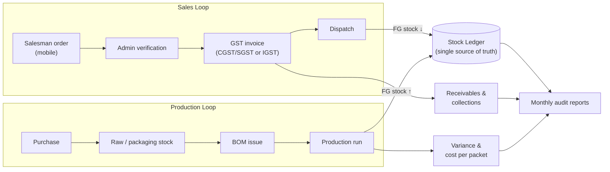

# FactoryLoop

**Order-to-Audit prototype for a small food manufacturer.**

FactoryLoop is an end-to-end ERP system built for the Centre for Digital Infrastructure, NIT Tiruchirappalli internship shortlisting task. It links the **sales loop** (field order → admin verification → GST invoice → dispatch → receivables) with the **production loop** (purchase → raw-material issue per BOM → production run → variance & costing) through a single, immutable **stock ledger**. Every transaction is entered once at its source and flows automatically into stock, production costing and accounts.

> **Hypothetical client:** Sri Lakshmi Foods — a small-scale manufacturer of packaged South Indian snacks (murukku, mixture, chips, sweets) based in Tiruchirappalli, Tamil Nadu.

---

## Architecture



Both loops meet at **finished-goods stock**. Every balance is derived from `stock_ledger` rows — no editable balance columns exist. All writes use PostgreSQL transactions, and business-critical changes are recorded in `audit_log`.

---

## Quick Start

```bash
docker compose up --build
```

| Service    | URL                       |
| ---------- | ------------------------- |
| Web app    | http://localhost          |
| REST API   | http://localhost:3000/api  |
| PostgreSQL | localhost:5432            |

The backend creates the schema and loads the Section 5 seed data on first start. To reset to a clean benchmark database:

```bash
docker compose down -v && docker compose up --build
```

### Manual setup (without Docker)

Prerequisites: Node.js 20+, PostgreSQL 15+.

```bash
# Terminal 1 — backend
createdb order_to_audit
cd backend
cp .env.example .env          # edit DATABASE_URL if needed
npm install
npm run init-db               # create tables
npm run seed                  # load benchmark data
npm run dev                   # starts on :3000

# Terminal 2 — frontend
cd frontend
npm install
npm run dev                   # starts on :5173
```

---

## Test Accounts

Password for every account: **`password123`** (dummy credentials for demo only).

| Role                   | Username      | What they see                                      |
| ---------------------- | ------------- | -------------------------------------------------- |
| Salesman A             | `salesman_a`  | Mobile order form, own orders, customer-wise sales  |
| Salesman B             | `salesman_b`  | Same, scoped to their customers                     |
| Factory Admin          | `admin`       | Orders, invoices, dispatch, purchases, payments     |
| Production Supervisor  | `production`  | BOMs, production runs, raw stock, inventory         |
| Accountant / Auditor   | `accountant`  | Read-only access to all reports                     |
| Owner                  | `owner`       | Summary dashboard — orders, stock, variance, dues   |

Each role sees only what it needs. Salesmen see only their own orders. The accountant has read-only report access. RBAC is enforced server-side via JWT middleware.

---

## Stack Rationale

React 18 + Vite + Tailwind CSS gives one responsive web app that serves both mobile salesmen and desktop factory staff. Node.js / Express keeps the API and business logic in a single language. PostgreSQL provides relational integrity, ACID transactions, `NUMERIC(15,4)` quantities, `BIGINT` paisa arithmetic (no floating-point drift), and locked financial-year invoice counters.

| Layer     | Technologies                                                       |
| --------- | ------------------------------------------------------------------ |
| Frontend  | React 18, Vite 5, React Router 6, Tailwind CSS, Radix UI, Axios   |
| Backend   | Node.js, Express, JWT + bcrypt, PDFKit, ExcelJS                    |
| Database  | PostgreSQL 15 (20 tables, 2 SQL functions, immutable stock ledger) |
| Testing   | Jest (17 assertions across 2 suites)                               |
| Infra     | Docker Compose, Nginx reverse proxy, Vercel (optional)             |

---

## Functional Coverage

### Must-have (Section 6 Tier 1 — all implemented)

| Requirement                              | Implementation                                                           |
| ---------------------------------------- | ------------------------------------------------------------------------ |
| ≥ 3 roles with RBAC                      | 5 roles — salesman, admin, production, accountant, owner; server-side `authorize()` middleware |
| Product, customer, raw-material & BOM masters | CRUD APIs + seeded Murukku 200g BOM with 5 ingredient lines            |
| Mobile field order entry + admin approval | Responsive order form; admin edits qty/price, approves or rejects        |
| GST-compliant invoice PDF                | GSTIN, HSN, taxable value, CGST/SGST or IGST by place of supply, FY numbering (`INV/2026-27/0001`) |
| Automatic production stock updates       | Raw/packaging issues and finished-goods output post to `stock_ledger` in one transaction |
| Consumption & yield variance             | BOM planned × multiplier vs actual; 3% tolerance; flagged alerts         |
| Stock summary + stock ledger             | Live WAC-valued balances; running ledger with source-document references  |
| Sales & stock Excel exports              | Date-filtered `.xlsx` via ExcelJS for all 9 report types                 |

### Should-have (Section 6 Tier 2 — all implemented)

| Requirement                              | Implementation                                                           |
| ---------------------------------------- | ------------------------------------------------------------------------ |
| Purchases & supplier master              | Supplier CRUD, multi-line purchase entry, receipt posts to stock ledger   |
| Payments, outstanding & ageing           | FIFO allocation, overpayment guard, 0–30 / 31–60 / 61–90 / 90+ buckets  |
| Cost per packet with overheads           | WAC materials + direct labour + gas/power per run → ₹/packet             |
| GST summary (GSTR-1 / GSTR-3B shape)    | Outward supplies grouped by tax rate × intra/inter-state                 |
| Variance alerts                          | Production detail view + owner dashboard flag absolute > 3%              |
| Owner summary dashboard                  | Today's orders, stock levels, variance alerts, cost per packet, dues     |

### Stretch goals (Section 6 Tier 3)

| Goal                                     | Status                     |
| ---------------------------------------- | -------------------------- |
| Offline order capture & sync             | Not implemented            |
| Batch / expiry tracking (FEFO)           | Schema columns exist; picking & expiry alerts not built |
| Reorder level alerts                     | Comparison logic exists; seed thresholds not populated  |
| Production planning, GPS visits, Tally export, e-Invoice/e-Way Bill, Tamil UI | Not implemented |

---

## Section 5 — Benchmark Scenario

Use a clean seeded database (`docker compose down -v && docker compose up --build`). All company, customer, supplier and transaction data is fictional.

### Master data

**BOM for Murukku 200g** — one batch = 200 packets expected:

| Item                | BOM qty     | Opening stock | Rate                            |
| ------------------- | ----------: | ------------: | ------------------------------- |
| Rice Flour          | 40 kg       | 100 kg        | ₹42/kg (opening), ₹45/kg (new) |
| Cooking Oil         | 10 L        | 30 L          | ₹140/L                         |
| Salt & Spice Mix    | 1.2 kg      | 5 kg          | ₹200/kg                        |
| 200g Pouch          | 200 pcs     | 500 pcs       | ₹2.50/pc                       |
| Carton (20 packets) | 10 pcs      | 30 pcs        | ₹15/pc                         |
| **Murukku 200g**    | 200 packets | 50 packets    | ₹50/packet (pre-GST 5%)        |

### Steps to demonstrate

1. **Purchase** — Record 60 kg Rice Flour at ₹45/kg.
2. **Production run** — Start Murukku 200g Standard Batch (multiplier 1). Issue 40 kg flour, 10.5 L oil, 1.2 kg spice mix.
3. **Complete run** — 188 good packets, 6 damaged pouches, 9 cartons used.
4. **Salesman A order** — 150 packets for Retailer A (Tamil Nadu).
5. **Admin invoice + dispatch** — Approve order, raise GST invoice (CGST + SGST), dispatch.
6. **Salesman B order** — 120 packets for Distributor B (Karnataka). System flags 32-packet shortage.
7. **Payment** — ₹4,000 received against Retailer A's invoice.
8. **Overheads** — Add ₹1,200 labour + ₹600 gas/power, then view cost per packet.
9. **Reports** — Generate and export the month's reports.

### Verified results

| Check                           | Expected                                      | Verified   |
| ------------------------------- | --------------------------------------------- | ---------- |
| Flour closing balance           | 120 kg (100 + 60 − 40)                        | ✅ 120 kg  |
| Oil closing balance             | 19.5 L (30 − 10.5)                            | ✅ 19.5 L  |
| Spice mix closing               | 3.8 kg (5 − 1.2)                              | ✅ 3.8 kg  |
| Pouches closing                 | 306 pcs (500 − 188 − 6)                       | ✅ 306     |
| Cartons closing                 | 21 pcs (30 − 9)                               | ✅ 21      |
| FG after production run         | 238 packets (50 + 188)                         | ✅ 238     |
| FG after Retailer A dispatch    | 88 packets (238 − 150)                         | ✅ 88      |
| Yield variance                  | −6% (188 vs 200), flagged (> 3%)               | ✅ Flagged |
| Oil consumption variance        | +5% (10.5 vs 10), flagged (> 3%)               | ✅ Flagged |
| Retailer A invoice total        | ₹7,500 + ₹187.50 CGST + ₹187.50 SGST = ₹7,875| ✅ ₹7,875  |
| Retailer A outstanding          | ₹7,875 − ₹4,000 = ₹3,875                     | ✅ ₹3,875  |
| Distributor B stock shortage    | 88 available < 120 requested = 32 short        | ✅ 32      |
| Invoice number                  | FY-sequenced                                   | ✅ `INV/2026-27/0001` |
| GST invoice PDF                 | Valid downloadable PDF                          | ✅ Generated |

### Cost per packet breakdown

Weighted-average costing. Flour WAC after purchase: ₹43.13/kg (₹43.125 → rounded to whole paisa).

| Component                        |     Cost |
| -------------------------------- | -------: |
| Rice Flour (40 kg × ₹43.13)     | ₹1,725.20 |
| Cooking Oil (10.5 L × ₹140)     | ₹1,470.00 |
| Salt & Spice Mix (1.2 kg × ₹200)| ₹240.00  |
| 200g Pouches (194 × ₹2.50)      | ₹485.00  |
| Cartons (9 × ₹15)               | ₹135.00  |
| **Materials subtotal**           | **₹4,055.20** |
| Labour                           | ₹1,200.00 |
| Gas / power                      | ₹600.00  |
| **Total batch cost**             | **₹5,855.20** |

**₹5,855.20 ÷ 188 packets = ₹31.14 per packet.** At ₹50 selling price (pre-tax), margin ≈ ₹18.86 (37.72%).

---

## Reports

All reports accept `dateFrom` / `dateTo` query parameters and export to `.xlsx` via `GET /api/reports/export/:type`.

| Report                 | Endpoint slug    | Contents                                              |
| ---------------------- | ---------------- | ----------------------------------------------------- |
| Sales register         | `sales`          | Invoice-wise + customer-wise + product-wise summaries  |
| GST summary            | `gst`            | Outward supplies by rate × supply type (GSTR-1 shape) |
| Purchase register      | `purchases`      | Line-level purchase detail with supplier               |
| Stock summary          | `stock`          | Current balances, WAC rate, stock value, status        |
| Stock ledger           | `stock-ledger`   | Every movement with source document + running balance  |
| Production report      | `production`     | Planned vs actual consumption, yield, flagged items    |
| Collections            | `collections`    | Payment-wise detail with mode and reference            |
| Outstanding / ageing   | `outstanding`    | Customer-wise receivables with FIFO ageing buckets     |
| Cost analysis          | `cost`           | Material + labour + overhead per packet, margin %      |

---

## Project Structure

```
order-to-audit/
├── backend/
│   ├── src/
│   │   ├── config/          # db.js — PostgreSQL pool, SSL auto-detect
│   │   ├── db/              # schema.sql, seed.sql, initDb.js, runSeed.js
│   │   ├── middleware/      # auth.js (JWT), rbac.js, auditLog.js
│   │   ├── routes/          # auth, dashboard, invoices, masters, orders,
│   │   │                    #   payments, production, purchases, reports
│   │   ├── services/        # costingService, gstService, pdfService,
│   │   │                    #   receivablesService, stockService, unitService
│   │   └── index.js         # Express entry point
│   ├── tests/               # stock.test.js, unitService.test.js (17 assertions)
│   ├── api/index.js         # Vercel serverless handler
│   ├── Dockerfile
│   └── package.json
├── frontend/
│   ├── src/
│   │   ├── api/client.js    # Axios instance
│   │   ├── components/      # Layout, DataTable, DateRangeFilter, ProtectedRoute,
│   │   │                    #   StockBadge, LoadingSpinner, ui/ (shadcn primitives)
│   │   ├── context/         # AuthContext.jsx
│   │   ├── pages/
│   │   │   ├── admin/       # Dashboard, orders, invoices, purchases, payments, customers
│   │   │   ├── production/  # Dashboard, production runs, BOM, inventory
│   │   │   ├── reports/     # 9 report pages (sales, GST, stock, production, cost, etc.)
│   │   │   ├── salesman/    # Dashboard, new order, order list
│   │   │   └── owner/       # Owner summary dashboard
│   │   └── utils/           # format.js, download.js
│   ├── Dockerfile
│   ├── nginx.conf           # API proxy + SPA fallback
│   └── package.json
├── docker-compose.yml       # db + backend + frontend — single command
├── DESIGN.md                # 2-page architectural design note
└── README.md
```

---

## Assumptions

- All business data is fictional (Section 5 or invented dummy records).
- **Money** is stored as integer paisa (`BIGINT`); JavaScript uses safe integer arithmetic. **Quantities** use `NUMERIC(15,4)`.
- **Stock** balances are always derived: opening + receipts − issues ± adjustments = closing. No editable balance columns.
- **Weighted Average Cost (WAC):** net value / net quantity, rounded to whole paisa. Issues and dispatches use the WAC at the time of transaction.
- **Pouch consumption** = good packets + damaged pouches. **Carton** use is entered explicitly by the production supervisor.
- **Labour and utilities** are directly allocated to the run (no monthly overhead pool).
- Opening finished goods have zero seeded cost; cost reports use new-run data.
- **GST:** Murukku at 5%. Tamil Nadu = state code `33`. Financial years run April–March.
- **Invoices are never deleted.** Cancellation generates a credit-note number, reverses payments, and restores stock.
- **WIP** is not a separate stock account; run status tracks draft → in_progress → completed.
- Dispatch is full-invoice (no partial dispatch). kg ↔ g and litre ↔ ml convert automatically; carton ↔ packet conversion is not guessed.

---

## Known Gaps

1. **Offline order capture** — PWA manifest exists but no service worker or IndexedDB sync queue.
2. **PDF export for reports** — Invoice PDFs work (PDFKit); other reports export as Excel only.
3. **Batch/expiry tracking** — Schema columns exist (`batch_number`, `expiry_date` on `stock_ledger`); FEFO picking and expiry alerts are not implemented.
4. **Demo video** — Not yet recorded.

---

## Verification

```bash
cd backend && npm test          # 17 Jest assertions — all pass
cd ../frontend && npm run build # Vite production build — zero errors
```

---

## Deployment

| Platform | Root dir    | Environment variables                                           |
| -------- | ----------- | --------------------------------------------------------------- |
| Backend  | `backend`   | `DATABASE_URL`, `JWT_SECRET`, `JWT_EXPIRES_IN`, `NODE_ENV`      |
| Frontend | `frontend`  | `VITE_API_URL` (defaults to `/api`, proxied to backend)         |

Use managed PostgreSQL (e.g. Supabase, Neon, Railway) for the hosted demo. Set a strong `JWT_SECRET` before public deployment.

---

## Design Note

See [`DESIGN.md`](DESIGN.md) for the data model (ER diagram), stock computation formulas, WAC costing methodology, and correctness controls.
