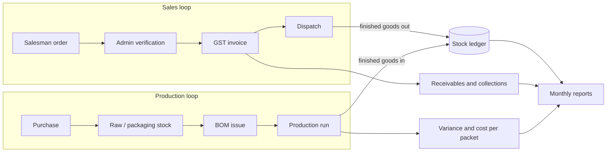

# FactoryLoop — Order-to-Audit Prototype

FactoryLoop is an individual prototype for the NIT Tiruchirappalli internship problem statement. It connects field orders, admin verification, GST billing, dispatch, BOM-based production, stock, costing, collections, and auditor reports in one PostgreSQL-backed system.

## Run locally

```bash
docker compose up --build
```

- Web: `http://localhost`
- API: `http://localhost:3000/api`
- PostgreSQL: `localhost:5432`

The backend creates the schema and loads the Section 5 seed data before starting. Reset to a clean benchmark database with:

```bash
docker compose down -v
docker compose up --build
```

`down -v` deletes the local Docker database volume and all demo transactions.

## Test logins

Password for every seeded account: `password123` — dummy credentials for local/demo use only.

| Role | Username | Main screen |
| --- | --- | --- |
| Salesman A | `salesman_a` | `/salesman/dashboard` |
| Salesman B | `salesman_b` | `/salesman/dashboard` |
| Factory Admin | `admin` | `/admin/dashboard` |
| Production Supervisor | `production` | `/production/dashboard` |
| Accountant / Auditor | `accountant` | `/reports` |
| Owner | `owner` | `/owner/dashboard` |

Salesmen see only their own orders. The accountant has read-only report access. Admin and owner have the broadest operational access; production users manage BOMs, purchases, and runs.

## Stack and why

React, Vite, React Router, Tailwind CSS, and shadcn-style Radix primitives let one responsive web app serve mobile sales staff and desktop factory users. Node.js/Express keeps the API and domain rules in one language, while PostgreSQL provides relational integrity, transactions, numeric quantities, ledger-based stock, and locked financial-year invoice counters.

**Stack:** React 18, Vite 5, React Router 6, Axios, TanStack Query, Tailwind CSS, Radix, Node.js, Express, JWT, bcrypt, PostgreSQL 15, PDFKit, ExcelJS, Jest, Docker Compose, and Vercel.

## Architecture



Every balance is derived from `stock_ledger`; each movement records its source type and ID. Business writes use database transactions, and invoice or production changes are written to `audit_log`.

## Section 6 


| Requirement | Implementation |
| --- | --- |
| At least three roles | Salesman, admin, production, accountant, owner; backend RBAC and protected routes |
| Product, customer, raw-material and BOM masters | Master APIs/screens and seeded Murukku data |
| Mobile order entry and admin approval | Responsive order form, stock check, edit/approve/reject |
| GST invoice PDF | GSTIN, HSN, taxable value, CGST/SGST or IGST, place of supply, FY numbering |
| Automatic production stock updates | Raw/packaging issues and finished output post to the ledger |
| Consumption and yield variance | BOM multiplier, actual issues, 3% tolerance, flagged alerts |
| Stock summary and ledger | Live balances, WAC valuation, running ledger, source references |
| Sales and stock exports | Date-filtered `.xlsx` reports |


| Requirement | Implementation |
| --- | --- |
| Purchases and suppliers | Supplier master, purchase entry, receipt ledger, purchase register |
| Payments, outstanding and ageing | Overpayment checks, FIFO allocation, 0–30/31–60/61–90/90+ buckets |
| Cost per packet with overheads | WAC materials plus direct labour and utilities per run |
| GST summary | Outward supplies by tax rate and intra/inter-state supply |
| Variance alerts | Production detail and owner dashboard |
| Owner dashboard | Orders, approvals, stock, variance, packet cost, receivables |

| Goal | Status |
| --- | --- |
| Offline order capture/sync | Not implemented |
| Batch/expiry and FEFO | Columns exist; picking, expiry alerts, and FEFO are not implemented |
| Reorder levels/low-stock alerts | Configurable comparison exists; seed thresholds are not populated |
| Production planning, GPS visits, Tally export, mock e-Invoice/e-Way Bill, Tamil UI | Not implemented |

## Section 5 benchmark

Use a clean seeded database. All company, customer, supplier, and transaction data is fictional.

### Master data

BOM for **Murukku 200 g**, one batch = 200 expected packets:

| Item | BOM quantity | Opening stock | Rate |
| --- | ---: | ---: | ---: |
| Rice Flour | 40 kg | 100 kg | ₹42 opening; ₹45 purchase |
| Cooking Oil | 10 L | 30 L | ₹140/L |
| Salt and Spice Mix | 1.2 kg | 5 kg | ₹200/kg |
| 200g Pouch | 200 pieces | 500 pieces | ₹2.50/piece |
| Carton (20 packets) | 10 pieces | 30 pieces | ₹15/carton |
| Murukku 200g | 200 packets expected | 50 packets | ₹50/packet before 5% GST |

### Demonstration order

1. Record a purchase of **60 kg Rice Flour at ₹45/kg**.
2. Start one **Murukku 200g Standard Batch**, multiplier `1`.
3. Issue **40 kg flour**, **10.5 L oil**, and **1.2 kg spice mix**.
4. Complete with **188 good packets**, **6 damaged pouches**, and **9 cartons**.
5. As `salesman_a`, order **150 packets** for **Retailer A — Tamil Nadu**.
6. As `admin`, approve, raise the GST invoice, download the PDF, and dispatch.
7. As `salesman_b`, order **120 packets** for **Distributor B — Karnataka**. Approval flags a **32-packet shortage**; IGST applies if invoiced.
8. Record **₹4,000** against Retailer A’s invoice.
9. Add **₹1,200 labour** and **₹600 gas/power**, then generate and export the month’s reports.

### Verified results

| Check | Expected | Verified |
| --- | --- | --- |
| Flour closing | 120 kg | 120 kg |
| Oil closing | 19.5 L | 19.5 L |
| Spice closing | 3.8 kg | 3.8 kg |
| Pouches closing | 306 | 306 |
| Cartons closing | 21 | 21 |
| Finished goods after run | 238 packets | 238 packets |
| Finished goods after dispatch | 88 packets | 88 packets |
| Yield variance | −6%, flagged | −6%, flagged |
| Oil variance | +5%, flagged | +5%, flagged |
| Retailer A invoice | ₹7,500 + ₹187.50 CGST + ₹187.50 SGST | ₹7,875 |
| Retailer A outstanding | ₹3,875 | ₹3,875 |
| Distributor B shortage | 32 packets | 32 packets |
| Invoice number | FY sequence | `INV/2026-27/0001` on a clean FY 2026–27 database |
| GST invoice PDF | Valid PDF | Generated successfully |

### Cost per packet

Weighted-average costing is used. Flour WAC rounds to **₹43.13/kg** after the purchase.

| Component | Cost |
| --- | ---: |
| Flour, oil, spice, pouches and cartons | ₹4,055.20 |
| Labour | ₹1,200.00 |
| Gas/power | ₹600.00 |
| **Total batch cost** | **₹5,855.20** |

`₹5,855.20 ÷ 188 = ₹31.1447`, stored/displayed as **₹31.14 per packet**. At ₹50 pre-tax, approximate margin is **₹18.86 per packet (37.72%)**.

The ₹0.20 batch difference from an unrounded flour average comes from rounding ₹43.125 to ₹43.13 because the ledger stores whole paisa. The final packet cost remains ₹31.14.

## Reports

Implemented reports: sales register, GST summary, purchase register, stock summary, stock ledger, production variance, collections, outstanding with FIFO ageing, and cost/margin.

Reports accept `dateFrom` and `dateTo` where applicable. Excel exports use `/api/reports/export/:type` for `sales`, `gst`, `stock`, `stock-ledger`, `production`, `purchases`, `collections`, `outstanding`, and `cost`.

## Assumptions

- All business data is fictional and follows Section 5 or invented dummy records.
- Money is integer paisa in PostgreSQL `BIGINT`; JavaScript uses safe integer arithmetic. Quantities use `NUMERIC(15,4)`.
- kg/g and litre/ml convert automatically; carton-to-packet conversion is not guessed.
- WAC includes inward and outward ledger value. Issues and dispatches use the current rounded moving average.
- Labour and utilities are directly allocated to the run. Pouches consumed equal good packets plus damaged pouches; carton use is explicit.
- Opening finished goods have zero seeded cost; cost reports use new-run cost, not blended stock WAC.
- WIP is not a separate stock account; run status tracks issue through completion. Dispatch is all-or-nothing per invoice.
- Murukku GST is 5%; Tamil Nadu is state code `33`; financial years run April–March.
- Stock summary is current stock; the ledger supports date-range opening and running balances.
- Invoices are cancelled, never deleted. Cancellation creates a credit-note number, reverses payments, and restores stock.


## Verification

```bash
cd backend && npm test
cd ../frontend && npm run build
```

Verified locally: **17 Jest tests passed**, frontend production build passed, Section 5 API/PostgreSQL benchmark passed, all nine Excel exports passed, GST PDF generated, and desktop/mobile login plus 390px no-overflow checks passed.

## Manual setup

Prerequisites: Node.js 20+, PostgreSQL 15+, npm.

```bash
createdb order_to_audit
cd backend
cp .env.example .env
npm install
npm run init-db
npm run seed
npm run dev
```

In a second terminal:

```bash
cd frontend
npm install
npm run dev
```

Open `http://localhost:5173`. Set a strong `JWT_SECRET` before public deployment. Set `VITE_API_URL` to use another API host.

## Deployment and submission status

- Vercel backend root: `backend`; set `DATABASE_URL`, `JWT_SECRET`, `JWT_EXPIRES_IN`, and `NODE_ENV`.
- Vercel frontend root: `frontend`, or use the root `vercel.json`; `/api` proxies to the deployed backend.
- Use managed PostgreSQL for the hosted demo.
- Source, schema, seed data, clear commit history, README, design note, test logins, run command, benchmark, and exports are present.
- Pending: demo video link and confirmation that the live deployment uses the latest code.
