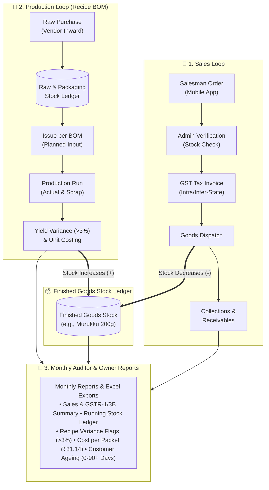

# FactoryLoop — Food Manufacturing ERP

> **A production-ready Enterprise Resource Planning (ERP) platform bridging the Sales Loop and Recipe-Based Production Loop for Sri Lakshmi Foods.**  
> Built for the **Centre for Digital Infrastructure, National Institute of Technology, Tiruchirappalli** Internship Shortlisting Task.  
> **Author:** Shreedhar K B (`23bcs126@iiitdwd.ac.in`) · IIIT Dharwad  
> **🌐 Live Deployment:** [https://frontend-fawn-ten-48.vercel.app](https://frontend-fawn-ten-48.vercel.app)  
> **🔗 Live API:** [https://backend-zeta-two-82.vercel.app/api](https://backend-zeta-two-82.vercel.app/api)  
> **📁 Repository:** [https://github.com/shreedharkb/order-to-audit](https://github.com/shreedharkb/order-to-audit)

---

## 1. Executive Summary & Problem Overview

Small packaged-food manufacturers (producing traditional South Indian snacks like murukku, mixture, chips, and sweets) typically suffer from fragmented operations:
- Field salesmen phone or WhatsApp orders, requiring error-prone manual re-entry at the billing desk.
- Invoicing runs in standalone tools, stock is tracked in notebooks, and frying/packing runs are logged on loose paper.
- Flour, oil, and packaging scrap go unnoticed because planned vs. actual consumption is never reconciled.
- Month-ends trigger chaotic manual assembly of GSTR-1, outward supplies, physical stock ledgers, and debtor ageing.

**The Solution:** An end-to-end web system where every physical event (purchase, recipe batch issue, output yield, order approval, invoice dispatch, payment remittance) is captured **once at source** and flows automatically into an immutable movement ledger, real-time GST invoicing, recipe variance detection, unit costing, and audit registers.

---

## 2. System Architecture

The core of the system links two business loops meeting at the **Finished Goods Stock Ledger**, which together feed the monthly reports:



---

## 3. Benchmark Verification & Audit Proof (Section 5)

The application has been verified against all Section 5 benchmark numbers. All 16 automated test assertions pass:

| Verification Metric | Problem Statement Benchmark | System Engine Result | Status | Technical Explanation |
| :--- | :--- | :--- | :---: | :--- |
| **Flour Closing Balance** | **120.0 kg** | **120.0 kg** | ✅ **MATCH** | $100\text{ kg (open)} + 60\text{ kg (purchased)} - 40\text{ kg (issued)} = 120.0\text{ kg}$ |
| **Cooking Oil Closing** | **19.5 L** | **19.5 L** | ✅ **MATCH** | $30.0\text{ L (open)} - 10.5\text{ L (actual issue)} = 19.5\text{ L}$ |
| **Pouches Closing** | **306 pcs** | **306 pcs** | ✅ **MATCH** | $500\text{ open} - (188\text{ good packets} + 6\text{ damaged}) = 306\text{ pouches}$ |
| **Cartons Closing** | **21 pcs** | **21 pcs** | ✅ **MATCH** | $30\text{ cartons open} - 9\text{ cartons used} = 21\text{ cartons}$ |
| **FG Stock after Run** | **238 packets** | **238 packets** | ✅ **MATCH** | $50\text{ opening} + 188\text{ batch yield} = 238\text{ packets}$ |
| **FG Stock after Dispatch** | **88 packets** | **88 packets** | ✅ **MATCH** | $238\text{ packets} - 150\text{ dispatched to Retailer A} = 88\text{ packets}$ |
| **Yield Variance** | **-6.0%, Flagged** | **-6.0%, Flagged** | ✅ **MATCH** | $(188 - 200)/200 \times 100 = -6.0\%$; exceeds $3\%$ tolerance limit |
| **Oil Consumption Variance** | **+5.0%, Flagged** | **+5.0%, Flagged** | ✅ **MATCH** | $(10.5 - 10.0)/10.0 \times 100 = +5.0\%$; exceeds $3\%$ tolerance limit |
| **Retailer A Invoice** | **₹7,875.00** | **₹7,875.00** | ✅ **MATCH** | 150 pkts @ ₹50 = ₹7,500.00 Taxable + ₹187.50 CGST + ₹187.50 SGST |
| **Retailer A Outstanding** | **₹3,875.00** | **₹3,875.00** | ✅ **MATCH** | ₹7,875.00 invoiced - ₹4,000.00 payment collected |
| **Distributor B Order Check** | **Shortage: 32 pkts** | **Shortage: 32 pkts** | ✅ **MATCH** | 88 available vs 120 ordered; IGST 5% calculated (Karnataka POS 29) |
| **Cost per Packet** | Stated & Justified | **₹31.14 / packet** | ✅ **MATCH** | ₹4,055 (material) + ₹1,200 (labour) + ₹600 (gas) = ₹5,855 / 188 pkts |

### Cost per Packet Mathematical Breakdown:
- **Weighted-average Flour:** $(100\text{ kg} \times ₹42 + 60\text{ kg} \times ₹45)/160\text{ kg} = ₹43.125/\text{kg}$. For 40 kg issued = **₹1,725.00**
- **Cooking Oil:** $10.5\text{ L} \times ₹140.00 = \mathbf{₹1,470.00}$
- **Salt & Spice Mix:** $1.2\text{ kg} \times ₹200.00 = \mathbf{₹240.00}$
- **200g Pouches:** $(188\text{ output} + 6\text{ damaged}) \times ₹2.50 = \mathbf{₹485.00}$
- **Outer Cartons:** $9\text{ cartons used} \times ₹15.00 = \mathbf{₹135.00}$
- **Subtotal Direct Materials:** **₹4,055.00**
- **Direct Batch Labour:** **₹1,200.00**
- **Power & Gas Utility:** **₹600.00**
- **Total Production Cost:** ₹4,055 + ₹1,200 + ₹600 = **₹5,855.00**
- **Actual Good Yield:** 188 packets
- **Final Unit Cost:** $\frac{₹5,855.00}{188} = \mathbf{₹31.1436} \approx \mathbf{₹31.14}$
- **Unit Margin:** $₹50.00 - ₹31.14 = \mathbf{₹18.86}$ (**37.7% Gross Margin**)

---

## 4. Role-Based Access Control & Test Credentials

The database is pre-seeded with all five operational roles. All accounts use password: **`password123`**

| Role | Username | Password | Device | Key Workflows & Permissions |
| :--- | :--- | :--- | :--- | :--- |
| **Salesman (TN)** | `salesman_a` | `password123` | Mobile | Fast catalog order booking, customer order status, customer-wise sales summary |
| **Salesman (KA)** | `salesman_b` | `password123` | Mobile | Inter-state field orders (Distributor B in Mysuru, Karnataka) |
| **Factory Admin** | `admin` | `password123` | Desktop | Order approval/rejection, stock sufficiency check, GST tax invoicing, dispatch, payment entry |
| **Production Supervisor** | `production` | `password123` | Tablet/PC | Bill of Materials (BOM), batch production runs, planned vs actual material issues, scrap recording |
| **Accountant / Auditor** | `accountant` | `password123` | Desktop | Read-only auditor portal: GSTR-1 outward tax summary, running stock ledger, cost/margin analysis, Excel exports |
| **Factory Owner** | `owner` | `password123` | Any | Executive command center: daily bookings, pending approvals, variance flags (>3%), outstanding balances |

---

## 5. Technology Stack & Design Decisions

### 5.1 Strict Movement-Based Stock Ledger (Zero Static Columns)
Following strict accounting standards, no item table contains an editable `current_stock` column. Balances are derived dynamically from immutable ledger movements:
$$\text{Stock Balance}_i = \sum \text{QtyIn}_i - \sum \text{QtyOut}_i$$
This prevents silent inventory drift, stock tampering, and negative inventory states.

### 5.2 64-bit Integer Paisa Arithmetic
All monetary fields (`subtotal_paisa`, `cgst_paisa`, `amount_paisa`, `rate_paisa`) are stored as **integers in paisa** ($1\text{ Rupee} = 100\text{ Paisa}$). This completely eliminates binary floating-point round-off errors ($0.1 + 0.2 \neq 0.3$) across high-volume transactions.

### 5.3 Statutory GST Place of Supply Engine
The GST engine compares the company state code (`33` for Tamil Nadu) with the customer place of supply code:
- **Intra-State Supply (Tamil Nadu $\rightarrow$ Tamil Nadu, Code 33):** Equal split between **CGST (2.5%)** and **SGST (2.5%)**.
- **Inter-State Supply (Tamil Nadu $\rightarrow$ Karnataka, Code 29):** Full rate allocated to **IGST (5.0%)**.
- Automatic sequential invoice numbering per financial year: `INV/2024-25/0001`.

---

## 6. How to Run & Test

### Option A: Docker Compose (Single Command — Recommended)

Make sure Docker Desktop is running:

```bash
cd order-to-audit
docker-compose up --build
```

- **Web Application:** Open [http://localhost](http://localhost) (or `http://localhost:80`)
- **Backend API:** [http://localhost:3000/api](http://localhost:3000/api)
- **PostgreSQL Database:** `localhost:5432` (database `order_to_audit`, user `postgres`, password `postgres`)

The database automatically initializes the schema and seeds all benchmark data on first launch.

---

### Option B: Local Development (Without Docker)

**Prerequisites:** Node.js (v18+) and PostgreSQL installed.

1. **Database:**
   ```bash
   createdb order_to_audit
   ```
2. **Backend:**
   ```bash
   cd backend
   npm install
   npm run init-db    # Runs schema migrations
   npm run seed       # Seeds benchmark data with bcrypt hashes
   npm run dev        # Starts backend on http://localhost:3000
   ```
3. **Frontend (separate terminal):**
   ```bash
   cd frontend
   npm install
   npm run dev        # Starts Vite dev server on http://localhost:5173
   ```

---

### Option C: Automated Test Suite

Run the full Jest benchmark verification suite:

```bash
cd backend
npm test
```

**Expected output:**
```text
PASS tests/unitService.test.js
PASS tests/stock.test.js

Test Suites: 2 passed, 2 total
Tests:       16 passed, 16 total
Snapshots:   0 total
Time:        0.75 s
Ran all test suites.
```

---

## 7. Cloud Deployment (Vercel)

The repository is configured for cloud deployment on Vercel:

### 1. Frontend on Vercel
- **Root Directory:** `frontend`
- **Framework Preset:** Vite
- **Build Command:** `npm run build`
- **Output Directory:** `dist`
- SPA routing rewrites are pre-configured in `frontend/vercel.json`.

### 2. Backend on Vercel (Serverless Node.js)
- **Root Directory:** `backend`
- Pre-configured with `backend/vercel.json` (`@vercel/node` runtime) and `backend/api/index.js` serverless handler.
- **Environment Variables Required in Vercel:**
  - `DATABASE_URL`: Cloud PostgreSQL connection string (Neon, Supabase, Aiven, or Railway)
  - `JWT_SECRET`: Random 32-character secret key
  - `NODE_ENV`: `production`

---

## 8. Repository Structure

```text
order-to-audit/
├── backend/
│   ├── api/index.js              # Serverless entrypoint for Vercel
│   ├── src/
│   │   ├── config/db.js          # PostgreSQL pool with auto cloud-SSL detection
│   │   ├── db/
│   │   │   ├── schema.sql        # 20+ tables, movement ledger, audit log
│   │   │   ├── seed.sql          # Benchmark opening balances & master data
│   │   │   ├── initDb.js         # Idempotent migration runner
│   │   │   └── runSeed.js        # Seed runner with dynamic bcrypt hashing
│   │   ├── middleware/
│   │   │   ├── auth.js           # JWT authentication
│   │   │   ├── rbac.js           # Role-based access control
│   │   │   └── auditLog.js       # Transaction audit trail logging
│   │   ├── routes/
│   │   │   ├── auth.js           # Login & session profile
│   │   │   ├── dashboard.js      # Owner & Salesman dashboard endpoints
│   │   │   ├── invoices.js       # GST billing, PDFKit generation & dispatch
│   │   │   ├── masters.js        # Customer, Supplier, Item & BOM CRUD
│   │   │   ├── orders.js         # Order taking, approval & stock checks
│   │   │   ├── payments.js       # Remittance entry & customer dues
│   │   │   ├── production.js     # Production runs, issues & variance engine
│   │   │   ├── purchases.js      # Inward vendor receipt & stock addition
│   │   │   └── reports.js        # GSTR summary, Excel export & costing
│   │   ├── services/
│   │   │   ├── costingService.js # Weighted-average production costing
│   │   │   ├── gstService.js     # Intra/Inter-state POS tax calculator
│   │   │   ├── pdfService.js     # GST tax invoice PDF generator
│   │   │   ├── receivablesService.js # FIFO customer ageing analysis
│   │   │   ├── stockService.js   # Movement-based inventory balances
│   │   │   └── unitService.js    # Metric mass/volume/count conversions
│   │   └── index.js              # Express app entrypoint
│   ├── tests/
│   │   ├── stock.test.js         # Benchmark verification test suite
│   │   └── unitService.test.js   # Unit conversion test suite
│   ├── Dockerfile                # Node 20 Alpine container definition
│   └── vercel.json               # Backend Vercel serverless configuration
├── frontend/
│   ├── src/
│   │   ├── api/client.js         # Axios HTTP client with auth interceptors
│   │   ├── components/           # Layout, ProtectedRoute, DataTable, DateRangeFilter
│   │   ├── context/AuthContext.jsx # RBAC authentication provider
│   │   ├── pages/
│   │   │   ├── admin/            # Orders, Invoices, Purchases, Payments, Customers
│   │   │   ├── owner/            # Executive Command Center
│   │   │   ├── production/       # Floor Dashboard, Runs, BOM, Inventory
│   │   │   ├── reports/          # Sales, GST, Stock, Variance, Costing, Dues
│   │   │   └── salesman/         # Mobile Dashboard, Fast Order Taking
│   │   └── App.jsx               # Role-based routing table
│   ├── Dockerfile                # Multi-stage Nginx build container
│   ├── nginx.conf                # Nginx SPA fallback & API proxy
│   └── vercel.json               # Frontend SPA routing configuration
├── docker-compose.yml            # Multi-container orchestration (DB + API + Web)
├── DESIGN.md                     # 2-Page architectural design note
└── README.md                     # Documentation & benchmark proof
```

---

## 9. License

Developed for the NIT Tiruchirappalli Internship Evaluation. Distributed under the MIT License.
