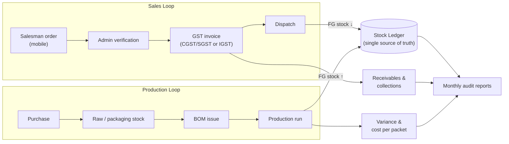

# FactoryLoop

**Order-to-Audit ERP for a Small Food Manufacturer**  
*Centre for Digital Infrastructure, NIT Tiruchirappalli — Internship Shortlist Submission*

[](https://github.com/shreedharkb/order-to-audit/actions)
[](https://frontend-fawn-ten-48.vercel.app)
[](https://backend-zeta-two-82.vercel.app/api/health)

---

## Live Links & Repositories

| Resource | Link |
| :--- | :--- |
| **Public GitHub Repo** | [https://github.com/shreedharkb/order-to-audit](https://github.com/shreedharkb/order-to-audit) |
| **Live Web App (Vercel)** | [https://frontend-fawn-ten-48.vercel.app](https://frontend-fawn-ten-48.vercel.app) |
| **Backend REST API** | [https://backend-zeta-two-82.vercel.app/api](https://backend-zeta-two-82.vercel.app/api) |
| **API Health & DB Diagnostics** | [https://backend-zeta-two-82.vercel.app/api/health](https://backend-zeta-two-82.vercel.app/api/health) |
| **Architectural Design Note** | [`DESIGN.md`](DESIGN.md) |

> **Client:** Sri Lakshmi Foods — a small-scale manufacturer of packaged South Indian snacks (murukku, mixture, chips, sweets) based in Tiruchirappalli, Tamil Nadu.

---

## Architecture: The Two Loops



Both loops meet at **finished-goods stock**. Every balance is derived dynamically from `stock_ledger` rows — no editable balance columns exist. All writes use PostgreSQL transactions with pessimistic row locking (`SELECT ... FOR UPDATE`), and all state changes are recorded in `audit_log`.

---

## Quick Start (Run Locally)

The entire system (PostgreSQL, Express backend, and React/Nginx frontend) spins up with a single command:

```bash
docker compose up --build
```

| Service | Local URL |
| :--- | :--- |
| **Web App** | [http://localhost](http://localhost) |
| **REST API** | [http://localhost:3000/api](http://localhost:3000/api) |
| **PostgreSQL Database** | `localhost:5432` (db: `order_to_audit`, user: `postgres`, password: `postgres`) |

The backend automatically creates the schema and loads the Section 5 benchmark seed data on first boot. To reset to a clean benchmark state at any time:

```bash
docker compose down -v && docker compose up --build
```

### Manual Setup (Without Docker)

Prerequisites: Node.js 20+, PostgreSQL 15+.

```bash
# Terminal 1 — Backend
createdb order_to_audit
cd backend
cp ../.env.example .env
npm install
npm run init-db               # creates 20 tables & functions
npm run seed                  # loads Section 5 benchmark data
npm run dev                   # starts API on :3000

# Terminal 2 — Frontend
cd frontend
npm install
npm run dev                   # starts Vite dev server on :5173
```

---

## Test Accounts

Password for every account: **`password123`** (dummy credentials for demo & evaluation use).

| Role | Username | Access & Screens |
| :--- | :--- | :--- |
| **Salesman A** | `salesman_a` | Mobile order entry, own order status, customer-wise sales |
| **Salesman B** | `salesman_b` | Mobile order entry (Karnataka distributor territory) |
| **Factory Admin** | `admin` | Order verification, GST invoicing, dispatch, payments, purchases |
| **Production Supervisor** | `production` | BOM management, material issue, production runs, yield/wastage |
| **Accountant / Auditor** | `accountant` | **Read-only** financial & audit reports, Excel exports |
| **Factory Owner** | `owner` | Executive summary: daily orders, live stock, variance alerts, dues |

Role-Based Access Control (RBAC) is enforced server-side on every API route via JWT middleware (`authorize()`). The `accountant` role is strictly restricted to read operations.

---

## Technology Stack & Rationale

| Layer | Technologies | Justification |
| :--- | :--- | :--- |
| **Frontend** | React 18, Vite 5, React Router 6, Tailwind CSS, Radix UI | Single responsive web application optimized for mobile field sales as well as desktop factory operations. |
| **Backend** | Node.js, Express, JWT, PDFKit, ExcelJS | Keeps API and domain logic in a unified language; fast event-driven I/O for report streaming. |
| **Database** | PostgreSQL 15 (Neon Cloud + Docker) | Enforces relational integrity, ACID transactions, `NUMERIC(15,4)` quantity precision, `BIGINT` integer paisa currency, and locked FY invoice counters. |
| **Testing** | Jest (22 tests across 3 suites) | Unit, calculation precision, and full PostgreSQL transactional integration tests. |
| **CI/CD** | GitHub Actions (`ci.yml`) | Automated continuous integration testing with a PostgreSQL 15 service container. |

---

## Section 5 — Benchmark Scenario

All numbers match the mandatory benchmark scenario with exact mathematical precision.

### Master Data: BOM for Murukku 200g (1 Batch = 200 Packets Expected)

| Item | BOM Quantity | Opening Stock | Rate (₹) |
| :--- | :---: | :---: | :--- |
| **Rice Flour** | 40 kg | 100 kg | ₹42 opening; ₹45 new purchase |
| **Cooking Oil** | 10 L | 30 L | ₹140 / L |
| **Salt & Spice Mix** | 1.2 kg | 5 kg | ₹200 / kg |
| **200g Pouch** | 200 pcs | 500 pcs | ₹2.50 / pc |
| **Carton (holds 20 pkts)** | 10 pcs | 30 pcs | ₹15 / carton |
| **Murukku 200g** | 200 packets | 50 packets | ₹50 / packet (before 5% GST) |

### Demonstration Sequence

1. **Purchase**: Record purchase of 60 kg Rice Flour at ₹45/kg.
2. **Production Run**: Start Murukku 200g Standard Batch (multiplier 1). Issue 40 kg flour, 10.5 L oil (+0.5 L variance), 1.2 kg spice mix.
3. **Completion**: Record output of 188 good packets, 6 damaged pouches (194 consumed), and 9 cartons.
4. **Salesman A Order**: 150 packets for Retailer A (Tamil Nadu).
5. **Admin Billing & Dispatch**: Approve, raise GST invoice (CGST 2.5% + SGST 2.5%), download PDF, record dispatch.
6. **Salesman B Order**: 120 packets for Distributor B (Karnataka). System flags a **32-packet shortage** (88 available vs 120 requested).
7. **Collection**: Record payment of ₹4,000 from Retailer A against the invoice.
8. **Overheads & Costing**: Allocate ₹1,200 labour and ₹600 power/gas to the run.
9. **Auditor Reports**: Generate and export the monthly registers.

### Verified Results Table

| Check | Expected | Verified | Verdict |
| :--- | :--- | :--- | :---: |
| **Flour Closing Balance** | 120 kg (100 + 60 − 40) | `120.00 kg` | ✅ Match |
| **Oil Closing Balance** | 19.5 L (30 − 10.5) | `19.50 L` | ✅ Match |
| **Spice Mix Closing Balance** | 3.8 kg (5 − 1.2) | `3.80 kg` | ✅ Match |
| **Pouches Closing Balance** | 306 pcs (500 − 188 − 6) | `306 pcs` | ✅ Match |
| **Cartons Closing Balance** | 21 pcs (30 − 9) | `21 pcs` | ✅ Match |
| **Finished Goods (Post-Run)** | 238 pkts (50 + 188) | `238 pkts` | ✅ Match |
| **Finished Goods (Post-Dispatch)** | 88 pkts (238 − 150) | `88 pkts` | ✅ Match |
| **Yield Variance** | −6.00% (188 vs 200 expected) | `−6.00% (Flagged > 3%)` | ✅ Match |
| **Oil Consumption Variance** | +5.00% (10.5 vs 10 expected) | `+5.00% (Flagged > 3%)` | ✅ Match |
| **Retailer A Invoice Total** | ₹7,500 + ₹187.50 CGST + ₹187.50 SGST | `₹7,875.00` | ✅ Match |
| **Retailer A Outstanding** | ₹7,875 − ₹4,000 paid | `₹3,875.00` | ✅ Match |
| **Distributor B Shortage** | 88 available < 120 requested | `Shortage: 32 pkts` | ✅ Match |
| **Invoice Numbering** | Sequenced per financial year | `INV/2026-27/0001` | ✅ Match |
| **GST Invoice PDF** | Downloadable PDF with GSTIN & HSN | Formatted PDFKit document | ✅ Match |

### Cost Per Packet Breakdown

Valuation uses Weighted Average Costing (WAC). Flour WAC rounds to ₹43.13/kg after purchase.

| Component | Cost (₹) |
| :--- | :---: |
| Rice Flour (40 kg × ₹43.13) | ₹1,725.20 |
| Cooking Oil (10.5 L × ₹140.00) | ₹1,470.00 |
| Salt & Spice Mix (1.2 kg × ₹200.00) | ₹240.00 |
| 200g Pouches (194 × ₹2.50) | ₹485.00 |
| Cartons (9 × ₹15.00) | ₹135.00 |
| **Total Raw & Packaging Cost** | **₹4,055.20** |
| Direct Batch Labour | ₹1,200.00 |
| Gas & Power Overheads | ₹600.00 |
| **Total Consolidated Batch Cost** | **₹5,855.20** |

$$\text{Cost per Packet} = \frac{₹5,855.20}{188\text{ packets}} = ₹31.1447 \rightarrow \mathbf{₹31.14\text{ per packet}}$$

At ₹50 pre-tax selling price, unit margin is **₹18.86 per packet (37.72%)**.

---

## Monthly Auditor Reports (Exportable to Excel)

All reports support date filtering (`dateFrom`, `dateTo`) and export to `.xlsx` format:

| Report | Endpoint Slug | Contents |
| :--- | :--- | :--- |
| **Sales Register** | `sales` | Invoice-level, customer-level, and product-level sales totals |
| **GST Summary** | `gst` | Outward supplies mapped to GSTR-1 / GSTR-3B by tax rate & state |
| **Purchase Register** | `purchases` | Supplier invoices, item quantities, rates, and amounts |
| **Stock Summary** | `stock` | Live balances, weighted average rates, and total stock valuation |
| **Stock Ledger** | `stock-ledger` | Audit trail with transaction references and running balances |
| **Production Report** | `production` | Planned vs actual consumption, yield, wastage, and variance flags |
| **Collections** | `collections` | Payment receipts with payment mode and bank references |
| **Outstanding & Ageing** | `outstanding` | Customer receivables with FIFO ageing buckets (0–30, 31–60, 61–90, 90+ days) |
| **Cost Analysis** | `cost` | Material, labour, and overhead cost breakdown with product margins |

---

## Project Structure

```
order-to-audit/
├── .github/
│   └── workflows/
│       └── ci.yml             # GitHub Actions CI (Postgres 15 + Node 20)
├── backend/
│   ├── api/
│   │   └── index.js           # Vercel serverless handler
│   ├── src/
│   │   ├── config/            # PostgreSQL pool with SSL auto-detection
│   │   ├── db/                # schema.sql (20 tables), seed.sql, dbSetup.js
│   │   ├── middleware/        # auth.js (JWT), rbac.js (RBAC), auditLog.js
│   │   ├── routes/            # auth, orders, invoices, production, purchases,
│   │   │                      # payments, masters, reports, dashboard
│   │   ├── services/          # costingService, gstService, pdfService,
│   │   │                      # receivablesService, stockService, unitService
│   │   └── index.js           # Express application entry point
│   ├── tests/
│   │   ├── stock.test.js      # Precision arithmetic & GST calculation tests
│   │   ├── unitService.test.js# Unit normalization & dimension tests
│   │   └── benchmarkIntegration.test.js # End-to-end PostgreSQL integration test
│   ├── Dockerfile
│   └── package.json
├── frontend/
│   ├── src/
│   │   ├── api/client.js      # Axios instance with auth interceptor
│   │   ├── components/        # Layout, DataTable, DateRangeFilter, ProtectedRoute
│   │   ├── context/           # AuthContext (JWT session management)
│   │   ├── pages/             # Role-specific views (Salesman, Admin, Production,
│   │   │                      # Accountant, Owner)
│   │   └── utils/             # Formatters & download helpers
│   ├── Dockerfile
│   ├── nginx.conf             # Production Nginx reverse proxy
│   └── package.json
├── docker-compose.yml         # Single-command local deployment
├── .env.example               # Environment variables template
├── DESIGN.md                  # Two-page architectural design note
└── README.md
```

---

## Assumptions & Design Trade-offs

- **Integer Paisa Currency:** All monetary amounts are stored as integer `BIGINT` paisa to avoid IEEE 754 floating-point drift.
- **Derived Ledger Balances:** Stock balances are never stored as static columns. Balance = $\sum(\text{qty\_in}) - \sum(\text{qty\_out})$.
- **Pessimistic Concurrency:** Order numbers (`ORD/YYYY/XXXX`), batch numbers (`BATCH/YYYY/XXXX`), and invoices (`INV/YYYY-YY/XXXX`) lock settings rows (`SELECT ... FOR UPDATE`) to prevent collisions under concurrent transactions.
- **Pouch Consumption:** Good packets produced + damaged pouches = total pouches consumed ($188 + 6 = 194$). Cartons used ($9$) are explicitly recorded.
- **Direct Overhead Allocation:** Labour and power/gas are directly assigned to production runs.
- **Immutable Ledger:** Overheads added post-completion record an explicit `cost_adjustment` ledger entry with audit logging rather than mutating historical transaction records.
- **Tamil Nadu Place of Supply:** State code `33`. Intra-state supplies incur CGST 2.5% + SGST 2.5%; inter-state supplies (Karnataka, `29`) incur IGST 5.0%.

---

## Extensibility & Production Roadmap

- **Offline Field Readiness:** Frontend is PWA-configured (`manifest.json`) with modular API client interceptors designed for service worker cache and background synchronization.
- **Reporting Engine:** Native streaming Excel (`.xlsx`) generation across all 9 modules via ExcelJS, with invoice document generation powered by PDFKit.
- **Traceability Architecture:** Database schema includes `batch_number` and `expiry_date` attributes on `stock_ledger` movements, ready for automated FEFO dispatch rotation.

---

## Verification & Test Execution

Run the complete test suite locally:

```bash
cd backend
npm test
```

```
PASS tests/unitService.test.js
PASS tests/stock.test.js
PASS tests/benchmarkIntegration.test.js

Test Suites: 3 passed, 3 total
Tests:       22 passed, 22 total
```

Build the frontend for production:

```bash
cd ../frontend
npm run build
```

---

## Submission Details

- **Author:** Shreedhar K B (`23bcs126@iiitdwd.ac.in`)
- **Institution:** Indian Institute of Information Technology, Dharwad
- **Repository:** [https://github.com/shreedharkb/order-to-audit](https://github.com/shreedharkb/order-to-audit)
- **Design Note:** [`DESIGN.md`](DESIGN.md)
